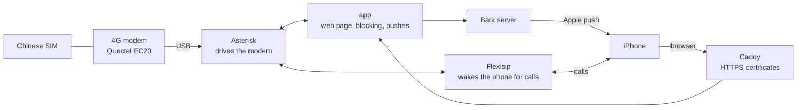

<div align="center">

[简体中文](README.md) · **English**

# sms-gateway

**Keep your Chinese phone number at home, get its texts and calls anywhere**

A self-hosted SMS and voice gateway: a USB 4G modem plus an always-on Linux box

[](LICENSE)


[Features](#features) · [How it works](#how-it-works) · [What you need](#what-you-need) · [Quick install](#quick-install) · [Security and privacy](#security-and-privacy) · [Glossary](#glossary)

</div>

---

## Why

I live in Japan but need to keep my China Unicom number: verification codes keep arriving there, and now and then someone calls it. Swapping SIM cards back and forth got old, and I didn't want a second phone.

So the Chinese SIM now sits in a USB 4G modem attached to my NAS at home. Texts are pushed to my iPhone and calls ring in Linphone, as if the SIM were still in the phone.

> [!NOTE]
> My setup: a China Unicom SIM roaming in Japan, a fnOS NAS, a router without NAT loopback, and haproxy already holding ports 80/443 on the NAS.
> Yours is probably different. Have a look at [other environments](docs/en/environments.md) before you start.

## Features

| | Feature | What it does |
|---|---|---|
| 💬 | SMS | New texts are pushed to iPhone and iPad; verification codes copy with one tap. Read and reply to conversations on the web page |
| 📞 | Calls | Rings even when the phone is locked (Linphone), or call right from the web page. Calls are encrypted end to end |
| 🛡️ | Spam blocking | Marketing texts, keywords, block and allow lists; nuisance calls are rejected automatically based on public number reports, leaving only a silent record |
| 🔎 | Number info | Region and carrier of a number, plus public reports such as "spam", "sales" or "delivery" |
| 📊 | Status page | Modem signal, band, temperature and VoLTE status, plus the host's load, memory and temperatures |
| 🔔 | Watchdog | Push alerts when something breaks, a short summary every morning, and a daily database backup |
| 🔐 | Login | The web page can be added to the home screen like an app; passkey (Face ID) login |

Everything runs on your own machine with Docker Compose. The push server is self-hosted as well, so your texts don't pass through anyone else's server.

## How it works



In short:

1. **Texts**: the modem receives a text → Asterisk hands it to the app → the app decides whether to block it → Bark pushes it to the phone.
2. **Calls**: a call comes in → the app decides whether to block it → if not, Flexisip wakes Linphone on the iPhone with a push → you answer.
3. **Web page**: the browser reaches the app through Caddy (HTTPS) to read and send texts, make calls and change settings.

<details>
<summary><b>What each service does</b></summary>

| Service | Role |
|---|---|
| `asterisk` | Open-source phone switch, with the chan_quectel plugin to drive the modem. A small script also reads the modem's signal and temperature every 30 seconds |
| `app` | The web page and all the logic, written in Python, data in SQLite |
| `bark` | Bark push server, official image |
| `caddy` | Gets HTTPS certificates automatically and routes the web page, Bark and the web phone |
| `flexisip` | Linphone's own SIP proxy. When the phone is asleep, it wakes Linphone through a push notification |
| `dns` | Optional. Only needed when your router has no NAT loopback |

</details>

## What you need

| Item | Required? | Notes |
|---|---|---|
| An always-on Linux machine | Yes | A NAS or mini PC that can run Docker and Docker Compose v2 |
| Quectel EC20 / EC25 USB modem | Yes | With an antenna. `lsusb` should show `2c7c:0125` |
| A Chinese SIM card | Yes | To make calls where 2G/3G is gone (Japan, the US...), both SIM and modem need VoLTE |
| A public IPv4 address | For calls | Your router must be able to forward ports. Not needed for texts only |
| A domain | For calls | Two subdomains; this guide uses `sms.example.com` and `sip.example.com` |
| Bark and Linphone on the iPhone | Yes | Both are on the App Store |
| A free linphone.org account | For calls | Needed for push notifications on incoming calls, [sign up here](https://subscribe.linphone.org) |

> [!TIP]
> Missing something? No public IP, texts only, an Android phone: [docs/en/environments.md](docs/en/environments.md) covers the alternatives.

---

## Quick install

With the modem and SIM plugged in, run this on the gateway machine:

```sh
curl -fsSL https://raw.githubusercontent.com/xyc0677/sms-gateway/main/install.sh | sudo bash
```

The script asks a few questions (domains, LAN IP, time zone, where backups go...). Most answers are detected for you, so you can just press Enter. It then:

- checks for Docker and offers to install it;
- finds the 4G modem, installs the udev rules and turns on the modem's USB audio;
- moves Caddy to other ports if 80/443 are already taken;
- writes `.env` with all the secrets;
- builds, starts and checks that the modem is online.

The first run takes about half an hour, mostly compiling Flexisip.

At the end it lists what only you can do, i.e. steps 2, 6, 7, 8 and 9 of the manual install below:
- DNS records;
- router port forwarding;
- first login;
- setting up Bark and Linphone on the phone.

> [!TIP]
> - Running it again is safe: an existing `.env` and its secrets are kept.
> - `--dry-run` only writes the configuration and changes nothing else on the system.
> - From a `git clone`, `sudo ./install.sh` does the same.

---

## Manual install

For doing it step by step, or to see what the quick install does. Run everything on the gateway machine; there are nine steps.

> [!NOTE]
> The web interface is in Chinese only. Menu names in this guide are translated; here is what to look for:
>
> | In this guide | On the page |
> |---|---|
> | Settings | 设置 |
> | Bark devices / Add device | Bark 推送设备 / 添加设备 |
> | Linphone push / Save and test | Linphone 来电推送 / 保存并测试 |
> | iPhone SIP account | iPhone SIP 账号 |
> | Passkeys | 通行密钥 |
> | Call blocking | 来电拦截 |
> | Advanced | 高级 |
> | Call from this page | 在网页里直接拨打 |

### Step 1　Prepare the modem

**What this does**: makes the system recognise the modem, stops it from going online by itself (roaming data is expensive), and turns on the modem's sound card (needed for calls).

Plug the modem in and check that the system sees it:

```sh
lsusb | grep 2c7c      # should list 2c7c:0125
ls /dev/ttyUSB*        # usually ttyUSB0 to ttyUSB3
```

Install the udev rules and check:

```sh
sudo cp host/77-quectel-sms-gateway.rules /etc/udev/rules.d/
sudo cp host/99-no-wwan-data.conf /etc/NetworkManager/conf.d/   # skip without NetworkManager
sudo udevadm control --reload && sudo udevadm trigger
ls -l /dev/quectel-at /dev/quectel-status                       # both must exist
```

The rules do three things:
- keep ModemManager away from the modem;
- give its two serial ports fixed names;
- name its sound card `Quectel`.

Finally turn on the modem's sound card. The setting is stored in the modem, so this is a one-off:

```sh
sudo apt install -y picocom
sudo picocom -b 115200 /dev/quectel-at
```

Type these two lines, pressing Enter after each. When you see `OK`, press `Ctrl-A` then `Ctrl-X` to leave:

```
AT+QCFG="usbcfg",0x2C7C,0x0125,1,1,1,1,1,0,1
AT+CFUN=1,1
```

The modem restarts. After ten seconds or so, `arecord -l` should list `Quectel`.

### Step 2　Get the code, set up DNS

```sh
sudo git clone https://github.com/xyc0677/sms-gateway.git /opt/sms-gateway
cd /opt/sms-gateway
```

At your DNS provider, add an **A record** for each subdomain pointing to your public IP.

> [!WARNING]
> On Cloudflare:
> - `sms` may be proxied (orange cloud), but `sip` must be "DNS only" (grey cloud): Linphone's port 5061 can't go through Cloudflare's proxy.
> - Without IPv6 at home, don't add AAAA records. The iPhone prefers IPv6, and a wrong record means it can't connect.

### Step 3　Fill in the configuration

```sh
sudo cp .env.example .env
sudo chmod 600 .env
```

Open `.env` and set these to your own values:

| Key | Value |
|---|---|
| `SMS_DOMAIN` | domain of the web page, e.g. `sms.example.com` |
| `SIP_DOMAIN` | domain for Linphone, e.g. `sip.example.com` |
| `LAN_IP` | this machine's address on your home network, e.g. `192.168.1.10` |
| `TZ` | your time zone, e.g. `Asia/Tokyo` |

There are also eight secrets. Don't make them up; generate them all at once:

```sh
for k in AMI_SECRET SESSION_SECRET SIP_PASSWORD FLEXIAPI_ROUTER_KEY INTERNAL_KEY BARK_PUSH_PASSWORD WEB_SIP_PASSWORD PBX_TOKEN; do
  sudo sed -i "s|^$k=.*|$k=$(openssl rand -hex 24)|" .env
done
```

> [!IMPORTANT]
> `.env` is full of passwords. Don't share it or upload it anywhere.

### Step 4　Choose where backups go

The database is backed up every night and kept for 30 days. Ideally the backups live on another disk, so a dead system disk loses nothing:

```sh
sudo mkdir -p /mnt/disk2/sms-gateway-backup
sudo touch /mnt/disk2/sms-gateway-backup/.sms-gateway-backup
```

Then set `BACKUP_DIR=/mnt/disk2/sms-gateway-backup` in `.env`. With only one disk, the default `./data/backup` works too; it needs the same empty file.

<details>
<summary>Why the empty file?</summary>

It's a marker. If that disk ever fails to mount, Docker silently creates an empty directory of the same name on the system disk, and backups would quietly land there. When the marker is missing, the gateway skips the backup and pushes an alert instead.

</details>

### Step 5　Start

```sh
sudo docker compose build      # the first build takes 20-40 minutes, mostly Flexisip
sudo docker compose up -d
sudo docker compose ps         # everything should be running
```

Check the modem:

```sh
sudo docker compose exec asterisk asterisk -rx "quectel show devices"
```

If State is `Free` and the carrier's name shows up, you're good.

> [!NOTE]
> Right after starting, Flexisip keeps logging `waiting for ...`. It's waiting for the HTTPS certificate and starts by itself once the certificate arrives.

### Step 6　Open ports on the router

In your router's "port forwarding" or "virtual server" settings, forward these to the gateway machine:

| Port | Protocol | Used for |
|---|---|---|
| 80, 443 | TCP | web page, certificates |
| 5061 | TCP | Linphone |
| 10000-10099 | UDP | call audio |

> [!CAUTION]
> Do **not** forward these:
> - **18300**: direct access to the web page. Requests arriving here count as coming from home, which for example allows setting the first password.
> - **5060/UDP**: Asterisk's internal port.
>
> If the machine runs a firewall such as ufw, allow the ports in the table above.

### Step 7　First login

For safety, the first password can only be set from your home network:

1. On a computer or phone at home, open `http://<LAN_IP>:18300` and set a password of at least 10 characters.
2. From then on, log in at `https://sms.example.com` from anywhere.
3. Recommended: in Safari on the iPhone, tap Share → Add to Home Screen; it then behaves like an app.
4. Recommended: add a passkey under Settings → Passkeys to log in with Face ID. This must be done on the https domain.

### Step 8　Connect Bark (text notifications)

1. In Bark on the iPhone, tap the server icon at the top right and add `https://sms.example.com/bark`.
2. Copy that server's test URL.
3. On the web page, go to Settings → Bark devices → Add device, and paste it.
4. Tap the device and send a test push.

Do the same on an iPad.

> [!TIP]
> Generate an encryption key under Settings → Advanced, then turn on push encryption in Bark on every device (AES256 / CBC, same key). Then not even Apple can read your texts.

### Step 9　Connect Linphone (calls)

**On the web page**: under Settings → Linphone push, enter your linphone.org username and password and tap "Save and test". It should say the push key is OK.

**On the iPhone**: open Linphone, choose "Use SIP account" and enter:

| Field | Value |
|---|---|
| Username | `iphone` |
| Password | `SIP_PASSWORD` from `.env`, also shown under Settings → iPhone SIP account |
| Domain | `sip.example.com` |
| Transport | TLS |

> [!IMPORTANT]
> In Linphone's settings, also set **media encryption** to **SRTP** and turn on push notifications. Without SRTP, incoming calls fail.

**Try it**: lock the iPhone and call the SIM from another phone. It should ring.

**Calls from the web page** need no setup: choose "Call from this page" on a number's page or the dial pad. Dial `*43` first: it's an echo test, so if you hear yourself, audio works.

### Afterwards: pick a blocking mode

Settings → Call blocking offers three modes:

| Mode | Effect |
|---|---|
| Smart (recommended) | Rejects numbers publicly reported as spam, fraud, sales or agents; everything else rings |
| Block all | Only numbers on the allow list get through; good if you only want texts |
| Block list only | Rejects only numbers you blocked yourself |

A rejected caller hears a busy tone. You only get a silent notification: no sound, the screen stays off.

---

## Special cases

<details>
<summary><b>nginx / haproxy / a panel already uses ports 80 and 443</b></summary>

<br>

Many NAS panels already hold 80/443. Then move Caddy to other ports, listening on localhost only. Add to `.env`:

```sh
CADDY_HTTP_PORT=18081
CADDY_HTTPS_PORT=18444
CADDY_BIND=127.0.0.1
```

Then have the existing proxy hand both domains to Caddy. HTTPS must use **TLS passthrough**: route by name only, without decrypting, because Caddy holds the certificate and Flexisip uses the same one. With haproxy:

```
frontend http-in
    bind :80
    acl smsgw hdr(host) -i sms.example.com sip.example.com
    use_backend smsgw_http if smsgw

frontend https-in
    bind :443
    mode tcp
    tcp-request inspect-delay 5s
    tcp-request content accept if { req_ssl_hello_type 1 }
    use_backend smsgw_tls if { req_ssl_sni -i sms.example.com sip.example.com }

backend smsgw_http
    server caddy 127.0.0.1:18081

backend smsgw_tls
    mode tcp
    server caddy 127.0.0.1:18444
```

nginx can do this with the `stream` module and `ssl_preread on`, but only if `stream` owns port 443. Panels such as 1Panel/OpenResty listen on 443 with the `http` module, which takes more rework; putting haproxy in front is easier.

</details>

<details>
<summary><b>Works outside, fails on home Wi-Fi</b></summary>

<br>

Most likely your router has no NAT loopback: devices at home can't reach your own public IP. Add to `.env`:

```sh
COMPOSE_PROFILES=lan-dns
LAN_DNS_UPSTREAM=192.168.1.1   # your router's IP
```

Run `sudo docker compose up -d`, then on the iPhone go to Settings → Wi-Fi → your network → Configure DNS → Manual, and enter `LAN_IP`.

At home, the SIP domain now resolves to the LAN address; other names are unaffected.

</details>

<details>
<summary><b>Calling other countries</b></summary>

<br>

To limit the damage of a leaked account, only numbers starting with +86 (China) and +81 (Japan) can be dialled. To add more countries, edit the `[outbound]` section of `asterisk/conf/extensions.conf`.

</details>

For more cases (no public IP, ports blocked by your ISP, Android, Synology, other modems), see [docs/en/environments.md](docs/en/environments.md). If something goes wrong during setup, start with [docs/en/troubleshooting.md](docs/en/troubleshooting.md).

---

## Security and privacy

**What protects you**

- Only three kinds of ports are reachable from the internet: the web page, Linphone and call audio. Everything else listens on localhost or the home network only.
- The web password is stored hashed (scrypt). Too many wrong guesses lock it:
  - 8 failures per IP within 15 minutes;
  - 30 failures from anywhere, after which password login pauses for 15 minutes.

  Passkey login keeps working while that happens.
- Only calls placed by the gateway itself can wake your phone. Forged requests from outside must authenticate, and nobody can relay traffic through your server. This relies on `PBX_TOKEN` in `.env`. If it leaks, set a new one and restart asterisk and flexisip.
- The gateway refuses to start if a secret in `.env` is missing or too short.

**Where your data goes**

| Where | What | Avoidable? |
|---|---|---|
| Baidu | numbers of unknown callers and senders, to look up public reports | Yes: turn off "Online number lookup" under Settings → Call blocking |
| Apple push service | content of Bark notifications | Yes: with push encryption on, Apple can't read it |
| linphone.org | incoming-call pushes, which may include the caller's number | No: Linphone needs it to ring while locked |

Texts, call history and backups are stored unencrypted on your own disks.

> [!NOTE]
> Found a security issue? Please report it privately through a GitHub [Security Advisory](../../security/advisories/new) rather than an issue.

---

## Day to day

**Logs**

```sh
cd /opt/sms-gateway
sudo docker compose logs -f app         # texts, blocking, alerts, backups
sudo docker compose logs -f asterisk    # calls and the modem
```

**Updating**

```sh
sudo git pull && sudo docker compose build && sudo docker compose up -d
```

If Flexisip restarted, open Linphone on the iPhone once so it registers again.

**Restoring a backup**

```sh
sudo docker compose stop app
sudo cp /mnt/disk2/sms-gateway-backup/sms-20261014.db data/app/sms.db
sudo rm -f data/app/sms.db-wal data/app/sms.db-shm
sudo docker compose start app
```

**Moving to another machine**: copy the `data/` directory and the `.env` file. Texts, certificates and push devices all live in `data/`.

---

## Glossary

| Term | Meaning |
|---|---|
| SIP | The common protocol for internet calls. Linphone, Asterisk and Flexisip all speak it |
| VoLTE | Phone calls over 4G. Japan, the US and others have shut down 2G/3G, so without VoLTE there are no calls |
| Asterisk | Open-source phone switch software; here it drives the 4G modem |
| Flexisip | Linphone's SIP server. When the iPhone is locked the app isn't running, so it has to be woken by a push |
| Bark | An iOS app that receives notifications from your own server |
| NAT loopback | Reaching your own server at home through your public address. Many routers can't |
| Reverse proxy | Receives all web requests and forwards them by name to the right service. Here that's Caddy |
| TLS passthrough | The proxy forwards encrypted HTTPS traffic as-is, choosing the target by name without decrypting |
| Passkey | Log in to websites with Face ID / fingerprint instead of a password; stored in iCloud Keychain |

---

## More documentation

| Document | Content |
|---|---|
| [docs/en/troubleshooting.md](docs/en/troubleshooting.md) | Common pitfalls during setup, in the order you'd hit them |
| [docs/en/environments.md](docs/en/environments.md) | No public IP, blocked ports, Android, other modems or NAS systems |
| [docs/en/internals.md](docs/en/internals.md) | Implementation details; read before changing code |

## Built with

- [Ionic](https://ionicframework.com) (MIT) and [JsSIP](https://jssip.net) (MIT): the web interface and the web phone, in `app/vendor`.
- [chan_quectel](https://github.com/IchthysMaranatha/asterisk-chan-quectel) (GPL-2.0) and [Flexisip](https://gitlab.linphone.org/BC/public/flexisip) (AGPL-3.0): downloaded at build time; the patches are in their directories.
- [bark-server](https://github.com/Finb/bark-server) (MIT): official image.
- Mobile number ranges from [kurisu994/phone_data](https://github.com/kurisu994/phone_data) (MIT), landline area codes from [eduosi/district](https://github.com/eduosi/district) (Apache-2.0).
- Number reports: one Baidu search per unknown caller or sender, cached for 30 days.

## License

The code and configuration written for this project are under the [MIT](LICENSE) license. The two patches follow the license of the project they modify: `asterisk/chan_quectel-cmt.patch` is GPL-2.0, `flexisip/lenient-pn-prid.patch` is AGPL-3.0. The front-end libraries (`app/vendor`) and the number data (`app/numdb`) keep their original licenses, listed in the previous section.
