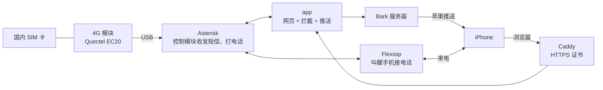

<div align="center">

# sms-gateway

**把国内手机卡插在家里，人在哪都能收短信、接电话**

用一块 USB 4G 模块加一台常开的 Linux 机器，搭一个自己的短信电话网关

[](LICENSE)


[能做什么](#能做什么) · [怎么工作的](#怎么工作的) · [准备清单](#准备清单) · [部署](#部署) · [安全和隐私](#安全和隐私) · [名词解释](#名词解释)

</div>

---

## 为什么做这个

我人在日本，国内的联通号还得留着：收验证码，偶尔接个电话。两张卡来回换太麻烦，双卡手机也不想买。

所以我把国内卡插在一块 USB 4G 模块上，接到家里的 NAS。短信会推送到 iPhone，电话用 Linphone 接，就像国内卡还在手机里一样。

> [!NOTE]
> 我的环境是：联通卡在日本漫游、飞牛 NAS、路由器不支持 NAT 回环、NAS 上已经有 haproxy 占着 80/443。
> 你的情况多半不一样，部署前可以先看看 [不同环境怎么改](docs/environments.md)。

## 能做什么

| | 功能 | 说明 |
|---|---|---|
| 💬 | 收发短信 | 新短信推送到 iPhone、iPad，验证码点一下就能复制；网页上能看会话、回短信 |
| 📞 | 接打电话 | 锁屏时也能响铃（Linphone）；也可以直接在网页里打。通话全程加密 |
| 🛡️ | 拦截骚扰 | 营销短信、关键词、黑白名单；骚扰电话按网上的号码标记自动拒接，只留一条静默记录 |
| 🔎 | 号码信息 | 显示归属地、运营商，以及“骚扰、推销、快递”这类网上标记 |
| 📊 | 状态页 | 模块信号、频段、温度、VoLTE 是否可用，还有机器的负载、内存、温度 |
| 🔔 | 自动值守 | 出故障会推送告警，每天早上推一条小结，数据库每天自动备份 |
| 🔐 | 登录 | 网页可以“添加到主屏幕”当 App 用，支持通行密钥（面容 ID）登录 |

全部用 Docker Compose 跑在你自己的机器上。推送服务器也是自建的，短信不经过别人的服务器。

## 怎么工作的



简单说：

1. **短信**：模块收到短信 → Asterisk 交给 app → app 判断要不要拦 → 用 Bark 推到手机。
2. **来电**：模块来电 → app 判断要不要拦 → 不拦就通过 Flexisip 推送叫醒 iPhone 上的 Linphone → 接起来就通了。
3. **网页**：浏览器通过 Caddy（负责 HTTPS）访问 app，可以看短信、回短信、打电话、改设置。

<details>
<summary><b>每个服务具体是干嘛的（点开看）</b></summary>

| 服务 | 作用 |
|---|---|
| `asterisk` | 开源电话交换机，加上 chan_quectel 插件来控制模块。另有一个小脚本，每 30 秒读一次模块的信号和温度 |
| `app` | Python 写的网页和全部业务逻辑，数据存在 SQLite |
| `bark` | Bark 推送的服务端，官方镜像 |
| `caddy` | 自动申请 HTTPS 证书，把网页、Bark、网页电话转给对应的服务 |
| `flexisip` | Linphone 官方的 SIP 代理。手机睡着时，靠它通过推送把 Linphone 叫醒 |
| `dns` | 可选。只有路由器不支持 NAT 回环时才需要 |

</details>

## 准备清单

| 要什么 | 必须吗 | 说明 |
|---|---|---|
| 一台常开的 Linux 机器 | 必须 | NAS、小主机都行，要能装 Docker 和 Docker Compose v2 |
| Quectel EC20 / EC25 USB 模块 | 必须 | 加天线。`lsusb` 里应该显示 `2c7c:0125` |
| 国内手机卡 | 必须 | 在日本这种没有 2G/3G 的地方要打电话，卡和模块都要支持 VoLTE |
| 公网 IPv4 | 打电话必须 | 路由器要能做端口转发。只收短信的话可以没有 |
| 一个域名 | 打电话必须 | 准备两个子域名，下文用 `sms.example.com` 和 `sip.example.com` 举例 |
| iPhone 上的 Bark 和 Linphone | 必须 | App Store 里都能搜到 |
| linphone.org 免费账号 | 打电话必须 | 锁屏来电推送要用，[在这注册](https://subscribe.linphone.org) |

> [!TIP]
> 条件不全也不一定不能用。没有公网 IP、只想收短信、用安卓手机，这些情况 [docs/environments.md](docs/environments.md) 里都写了替代办法。

---

## 部署

下面的命令都在网关机器上执行，一共九步。第一次从头到尾大概要一个小时，大部分时间在等编译。

### 第 1 步　准备模块

**这一步做什么**：让系统认出模块，别让它自己联网（漫游流量很贵），再打开模块的声卡（打电话用）。

插上模块，看系统认不认：

```sh
lsusb | grep 2c7c      # 应该有 2c7c:0125
ls /dev/ttyUSB*        # 一般是 ttyUSB0 到 ttyUSB3
```

装 udev 规则，然后检查一下：

```sh
sudo cp host/77-quectel-sms-gateway.rules /etc/udev/rules.d/
sudo cp host/99-no-wwan-data.conf /etc/NetworkManager/conf.d/   # 没有 NetworkManager 就跳过
sudo udevadm control --reload && sudo udevadm trigger
ls -l /dev/quectel-at /dev/quectel-status                       # 两个都要有
```

这条规则做三件事：
- 不让系统自带的 ModemManager 碰这个模块；
- 给模块的两个串口起固定的名字；
- 给模块的声卡起名 `Quectel`。

最后打开模块的声卡。这个设置会存在模块里，只用做一次：

```sh
sudo apt install -y picocom
sudo picocom -b 115200 /dev/quectel-at
```

进去后输入下面两行，每行按一次回车，看到 `OK` 后按 `Ctrl-A` 再按 `Ctrl-X` 退出：

```
AT+QCFG="usbcfg",0x2C7C,0x0125,1,1,1,1,1,0,1
AT+CFUN=1,1
```

模块会自己重启。等十几秒后运行 `arecord -l`，能看到 `Quectel` 就说明成功了。

### 第 2 步　下载代码，设置域名

```sh
sudo git clone https://github.com/xyc0677/sms-gateway.git /opt/sms-gateway
cd /opt/sms-gateway
```

到你的域名服务商那里，给两个子域名都加一条 **A 记录**，指向你家的公网 IP。

> [!WARNING]
> 用 Cloudflare 的话要注意：
> - `sms` 可以开代理（橙色云），`sip` 必须选“仅 DNS”（灰色云），因为 Linphone 用的 5061 端口过不了 Cloudflare 代理。
> - 家里没有 IPv6 的话，别加 AAAA 记录。iPhone 会优先走 IPv6，记录又是错的，就会连不上。

### 第 3 步　填写配置文件

```sh
sudo cp .env.example .env
sudo chmod 600 .env
```

打开 `.env`，把这几项改成你自己的：

| 项目 | 填什么 |
|---|---|
| `SMS_DOMAIN` | 网页的域名，比如 `sms.example.com` |
| `SIP_DOMAIN` | Linphone 的域名，比如 `sip.example.com` |
| `LAN_IP` | 这台机器在家里局域网的 IP，比如 `192.168.1.10` |
| `TZ` | 时区，国内填 `Asia/Shanghai` |

还有八个密钥，不用自己想，用这个命令一次生成：

```sh
for k in AMI_SECRET SESSION_SECRET SIP_PASSWORD FLEXIAPI_ROUTER_KEY INTERNAL_KEY BARK_PUSH_PASSWORD WEB_SIP_PASSWORD PBX_TOKEN; do
  sudo sed -i "s|^$k=.*|$k=$(openssl rand -hex 24)|" .env
done
```

> [!IMPORTANT]
> `.env` 里全是密码，别发给别人，也别传到网上。

### 第 4 步　设置备份位置

数据库每天凌晨自动备份一次，保留 30 天。备份最好放在另一块硬盘上，这样系统盘坏了也不怕：

```sh
sudo mkdir -p /mnt/disk2/sms-gateway-backup
sudo touch /mnt/disk2/sms-gateway-backup/.sms-gateway-backup
```

然后在 `.env` 里写上 `BACKUP_DIR=/mnt/disk2/sms-gateway-backup`。只有一块硬盘的话，用默认的 `./data/backup` 也行，同样要建这个空文件。

<details>
<summary>为什么要建一个空文件？</summary>

它是一个标记。如果哪天那块盘没挂载上，Docker 会在系统盘上自动建一个同名的空目录，备份就会悄悄写进系统盘。有了这个标记，程序发现标记不在，就不备份，并推送告警提醒你。

</details>

### 第 5 步　启动

```sh
sudo docker compose build      # 第一次要二三十分钟，主要在编译 Flexisip
sudo docker compose up -d
sudo docker compose ps         # 所有服务都应该是 running
```

检查模块连上没有：

```sh
sudo docker compose exec asterisk asterisk -rx "quectel show devices"
```

看到 State 是 `Free`，并且显示了运营商名字，就没问题。

> [!NOTE]
> 刚启动时 Flexisip 的日志里会一直出现 `waiting for ...`，这是在等 HTTPS 证书，正常现象。证书申请下来后它会自己启动。

### 第 6 步　路由器开端口

在路由器的“端口转发”或“虚拟服务器”里，把下面这些端口转发到网关机器：

| 端口 | 协议 | 用来干嘛 |
|---|---|---|
| 80、443 | TCP | 网页、申请证书 |
| 5061 | TCP | Linphone 连接 |
| 10000-10099 | UDP | 通话的声音 |

> [!CAUTION]
> 下面这些端口**不要**转发出去：
> - **18300**：网页的直连端口。程序会把从这里进来的请求当成家里的请求，比如允许第一次设置密码。
> - **5060/UDP**：Asterisk 的内部端口。
>
> 机器上开了 ufw 之类的防火墙的话，记得放行上面表格里那几个端口。

### 第 7 步　第一次登录网页

为了安全，第一次设密码只能在家里的局域网里做：

1. 在家里的电脑或手机上打开 `http://<LAN_IP>:18300`，设一个 10 位以上的密码。
2. 之后在任何地方都用 `https://sms.example.com` 登录。
3. 推荐：在 iPhone 的 Safari 里点“分享 → 添加到主屏幕”，用起来就跟 App 一样。
4. 推荐：在「设置 → 通行密钥」里加一个通行密钥，以后刷脸就能登录。这一步要在 https 域名下做。

### 第 8 步　接上 Bark（收短信推送）

1. 打开 iPhone 上的 Bark，点右上角的服务器图标，添加服务器 `https://sms.example.com/bark`。
2. 在这个服务器下面，复制它的测试链接。
3. 到网页「设置 → Bark 推送设备 → 添加设备」，把链接粘贴进去。
4. 点这台设备，发一条测试推送试试。

iPad 也照这样加。

> [!TIP]
> 建议在「设置 → 高级」里生成一个加密密钥，然后在每台设备的 Bark 里打开推送加密，选 AES256 / CBC，填同一个密钥。这样连苹果也看不到你的短信内容。

### 第 9 步　接上 Linphone（接打电话）

**先在网页上**：打开「设置 → Linphone 来电推送」，填上 linphone.org 的账号和密码，点“保存并测试”，看到“推送密钥正常”就行。

**再到 iPhone 上**：打开 Linphone，选“使用 SIP 账号”，填写：

| 项目 | 填什么 |
|---|---|
| 用户名 | `iphone` |
| 密码 | `.env` 里的 `SIP_PASSWORD`，网页「设置 → iPhone SIP 账号」里也能看到 |
| 域名 | `sip.example.com` |
| 传输 | TLS |

> [!IMPORTANT]
> 还要到 Linphone 的设置里，把**媒体加密**改成 **SRTP**，并打开推送通知。不改的话来电会直接失败。

**试一下**：锁上 iPhone，用别的手机给这张卡打个电话，应该会响。

**网页也能打电话**：在号码详情或拨号盘里选“在网页里直接拨打”就行，不用额外设置。第一次可以先拨 `*43`，这是回声测试，能听到自己说话就说明声音是通的。

### 完成后：选拦截方式

在「设置 → 来电拦截」里有三种方式：

| 方式 | 效果 |
|---|---|
| 智能拦截（推荐） | 只拒接被网上标记为骚扰、诈骗、推销、中介的号码，其他照常响铃 |
| 全部拦截 | 只有白名单里的号码能打进来，适合只收短信的人 |
| 只拦黑名单 | 只拒接你自己拉黑的号码 |

被拒接的电话，对方听到的是忙音。你这边只会多一条静默通知，不响也不亮屏。

---

## 特殊情况

<details>
<summary><b>机器上已经有 nginx / haproxy / 1Panel 占着 80、443 端口</b></summary>

<br>

很多 NAS 装了面板，80/443 早就被占了。这时让 Caddy 换个端口、只在本机监听，在 `.env` 里加：

```sh
CADDY_HTTP_PORT=18081
CADDY_HTTPS_PORT=18444
CADDY_BIND=127.0.0.1
```

再让原来的代理把这两个域名转给 Caddy。HTTPS 要用 **TLS 透传**：只看域名转发，不在前面解密。因为证书由 Caddy 管，Flexisip 也要用同一张证书。haproxy 的写法如下：

```
frontend http-in
    bind :80
    acl smsgw hdr(host) -i sms.example.com sip.example.com
    use_backend smsgw_http if smsgw

frontend https-in
    bind :443
    mode tcp
    tcp-request inspect-delay 5s
    tcp-request content accept if { req_ssl_hello_type 1 }
    use_backend smsgw_tls if { req_ssl_sni -i sms.example.com sip.example.com }

backend smsgw_http
    server caddy 127.0.0.1:18081

backend smsgw_tls
    mode tcp
    server caddy 127.0.0.1:18444
```

nginx 也能用 `stream` 模块加 `ssl_preread on` 实现，但前提是 443 由 stream 模块接管。1Panel/OpenResty 默认是 http 模块在监听 443，改起来比较麻烦，建议在前面加一层 haproxy。

</details>

<details>
<summary><b>在外面能连上，在家里 Wi-Fi 下连不上</b></summary>

<br>

多半是路由器不支持 NAT 回环：在家里访问不到自己家的公网 IP。解决办法是在 `.env` 里加：

```sh
COMPOSE_PROFILES=lan-dns
LAN_DNS_UPSTREAM=192.168.1.1   # 填你的路由器 IP
```

执行 `sudo docker compose up -d`，然后在 iPhone 上：设置 → 无线局域网 → 点你家 Wi-Fi → 配置 DNS → 手动，填 `LAN_IP`。

这样在家时，SIP 域名会直接解析到局域网地址，其他网站不受影响。

</details>

<details>
<summary><b>想拨打国外号码</b></summary>

<br>

为了防止账号泄露后被人拿去打国际长途，默认只能拨 +86（中国）和 +81（日本）开头的号码。要加别的国家，改 `asterisk/conf/extensions.conf` 里的 `[outbound]` 一节。

</details>

更多情况，比如没有公网 IP、端口被运营商封了、安卓手机、群晖 NAS、别的模块型号，见 [docs/environments.md](docs/environments.md)。部署时遇到问题，先看 [docs/troubleshooting.md](docs/troubleshooting.md)。

---

## 安全和隐私

**安全方面做了这些**

- 能从外网访问的只有网页、Linphone 和通话声音这三类端口，其它端口都只在本机或家里能用。
- 网页密码加密存储。猜错太多次会被锁：
  - 每个 IP 15 分钟内最多错 8 次；
  - 所有人加起来错满 30 次，密码登录暂停 15 分钟。

  这时你用通行密钥照样能登录。
- 只有网关自己发出的来电能叫醒你的手机。外人伪造的请求都会被要求输入密码，也没法借你的服务器去骚扰别人。这靠的是 `.env` 里的 `PBX_TOKEN`。万一泄露了，换一个新的，再重启 asterisk 和 flexisip。
- `.env` 里的密钥没填或太短，程序会拒绝启动。

**你的数据会经过这几个地方**

| 去哪里 | 什么数据 | 能不能避免 |
|---|---|---|
| 百度 | 陌生来电和短信的号码，用来查号码标记 | 能，在「设置 → 来电拦截」关掉“联网查询号码标记” |
| 苹果推送 | Bark 推送的内容 | 能，打开推送加密后苹果看不到内容 |
| linphone.org | 来电推送，可能带着来电号码 | 不能，Linphone 锁屏来电必须走它 |

短信、通话记录和备份都存在你自己的硬盘上，没有加密。

> [!NOTE]
> 发现安全问题的话，请通过 GitHub 的 [Security Advisory](../../security/advisories/new) 私下告诉我，别直接开 issue。

---

## 日常使用和维护

**看日志**

```sh
cd /opt/sms-gateway
sudo docker compose logs -f app         # 短信、拦截、告警、备份
sudo docker compose logs -f asterisk    # 通话和模块
```

**更新到新版本**

```sh
sudo git pull && sudo docker compose build && sudo docker compose up -d
```

更新后如果 Flexisip 重启了，要在 iPhone 上打开一次 Linphone，让它重新连上。

**从备份恢复**

```sh
sudo docker compose stop app
sudo cp /mnt/disk2/sms-gateway-backup/sms-20261014.db data/app/sms.db
sudo rm -f data/app/sms.db-wal data/app/sms.db-shm
sudo docker compose start app
```

**换机器**：把 `data/` 目录和 `.env` 文件一起拷过去就行。短信、证书、推送设备都在 `data/` 里。

---

## 名词解释

| 名词 | 是什么 |
|---|---|
| SIP | 网络电话的通用协议。Linphone、Asterisk、Flexisip 之间都用它通信 |
| VoLTE | 用 4G 网络打电话。日本、美国等地已经关掉了 2G/3G，没有 VoLTE 就打不了电话 |
| Asterisk | 开源的电话交换机软件，这里用它来控制 4G 模块 |
| Flexisip | Linphone 官方的 SIP 服务器。iPhone 锁屏时，App 不在运行，要靠它发推送把 Linphone 叫醒 |
| Bark | 一个 iOS 推送 App，能接收自己服务器发来的通知 |
| NAT 回环 | 在家里通过公网地址访问自己家的服务器。很多路由器不支持 |
| 反向代理 | 在前面统一接收网页请求，再按域名转给后面不同的服务。这里是 Caddy |
| TLS 透传 | 反向代理不解密 HTTPS，只看域名就把加密数据原样转走 |
| 通行密钥 | 用面容 ID / 指纹代替密码登录网站，存在 iCloud 钥匙串里 |

---

## 更多文档

| 文档 | 内容 |
|---|---|
| [docs/troubleshooting.md](docs/troubleshooting.md) | 部署时容易踩的坑，按步骤排好了 |
| [docs/environments.md](docs/environments.md) | 没有公网 IP、端口被封、安卓手机、别的模块或 NAS 等情况怎么改 |
| [docs/internals.md](docs/internals.md) | 实现细节，改代码前看 |

## 用到的开源项目

- [Ionic](https://ionicframework.com)（MIT）和 [JsSIP](https://jssip.net)（MIT）：网页界面和网页电话，放在 `app/vendor`。
- [chan_quectel](https://github.com/IchthysMaranatha/asterisk-chan-quectel)（GPL-2.0）和 [Flexisip](https://gitlab.linphone.org/BC/public/flexisip)（AGPL-3.0）：构建时下载，补丁在各自的目录里。
- [bark-server](https://github.com/Finb/bark-server)（MIT）：官方镜像。
- 手机号段数据来自 [kurisu994/phone_data](https://github.com/kurisu994/phone_data)（MIT），座机区号来自 [eduosi/district](https://github.com/eduosi/district)（Apache-2.0）。
- 号码标记：有来电或短信时去百度搜一次，结果缓存 30 天。

## 许可

本项目自己写的代码和配置用 [MIT](LICENSE) 许可。两个补丁跟随它们所修改的上游项目的许可：`asterisk/chan_quectel-cmt.patch` 是 GPL-2.0，`flexisip/lenient-pn-prid.patch` 是 AGPL-3.0。前端库（`app/vendor`）和号码数据（`app/numdb`）保留各自原来的许可，见上一节。
